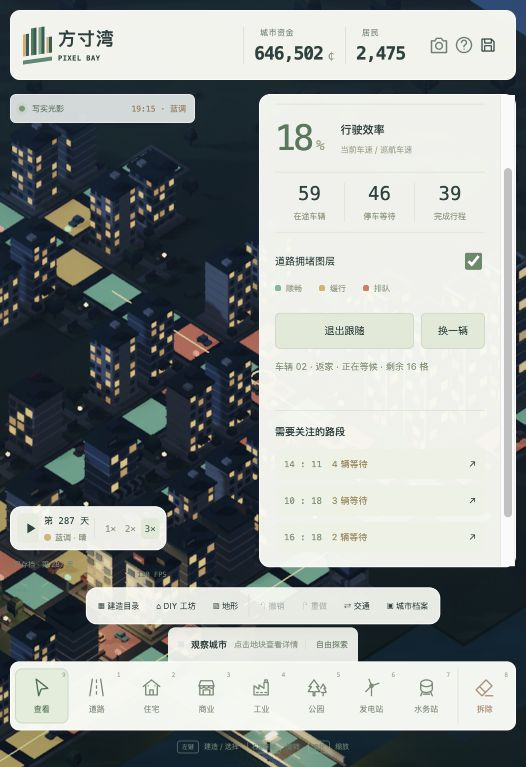

# 方寸湾 · Pixel Bay

**从一条道路开始，建造一座会生长、会流动的小城。**

方寸湾是一款在浏览器中运行的 **3D 像素城市模拟建设原型**，参考《SimCity》的经营玩法与《Cities: Skylines》的城市观察视角。用程序化体素建筑构建街区，以物理材质、昼夜照明和水面反射探索像素风与写实光影的结合。

当前版本：**v2.2 · 城市交通版**（2026-11-10）。支持城市建设、DIY 建筑、基础经营、抽样交通与本地存档，仍在持续开发中。

[快速开始](#快速开始) · [玩法与操作](#玩法与操作) · [交通系统](#交通系统) · [开发与测试](#开发与测试) · [更新记录](TRAFFIC-RELEASE.txt)

<p align="center">
  
</p>

## 已实现功能

| 系统 | 当前能力 |
| --- | --- |
| 城市建设 | 32 × 32 地图、连续拖绘道路、跨水自动建桥、多格占地校验、整栋拆除、三级建筑升级 |
| 建筑目录 | 5 种住宅、6 种商业、3 种公园、6 种公共服务建筑，以及基础工业与水电设施 |
| DIY 工坊 | 7 种风格、1–12 层、1–3 格宽深、4 个朝向、墙面颜色与 3 种屋顶 |
| 可选组件 | 庭院、围墙、车库、泳池、露台、太阳能；组件位置由模板安排 |
| 蓝图 | 命名、保存、复用、JSON 导入导出，最多保留 40 份 |
| 经营模拟 | 人口、就业、水电供需、税收、维护费用、商业客流与酒店住客 |
| 公共服务 | 教育、医疗、消防、治安、文化、文体的服务范围和容量影响幸福度与地价 |
| 交通观察 | 道路寻路、平滑转弯、车距检测、红灯等待、拥堵图层、路段定位、车辆跟随 |
| 地形与编辑 | 空闲地块填土、开挖水域；最近 60 次建设操作可撤销、重做 |
| 画面 | PBR 材质、动态光照、连续昼夜、夜间亮灯、水面反射、三档画质 |
| 存档 | 自动保存、3 个手动档案、城市 JSON 导入导出、旧版本迁移与损坏恢复 |

## 快速开始

### 运行源码版

需要 Git、Python 3，以及支持 WebGL2 的现代浏览器。Three.js 已随仓库提供，**无需安装 npm 依赖或执行构建**。

```bash
git clone https://github.com/JANZeee/pixel-bay.git
cd pixel-bay
python3 -m http.server 4173 --directory dist
```

打开 **http://localhost:4173**。在终端按 `Ctrl+C` 停止服务。

Windows 如果没有 `python3` 命令，可以使用：

```powershell
py -3 -m http.server 4173 --directory dist
```

源码使用 ES Modules，请通过本地 HTTP 服务运行，避免直接双击 `dist/index.html`。

### 使用离线单文件版

下载 [downloads/pixel-bay.html](https://github.com/JANZeee/pixel-bay/raw/refs/heads/main/downloads/pixel-bay.html)，保存后使用支持 WebGL2 的浏览器打开。此文件已打包脚本与样式，无需本地服务器。

[源码压缩包](downloads/pixel-bay-source.zip)是 v2.2 发布时的快照；获取最新代码与文档请克隆仓库。`downloads/` 中的文件不会随着源码编辑自动重新生成。

## 玩法与操作

### 第一座街区

1. 从地图西侧入口延伸道路，让新街区接入城市路网。
2. 沿路布置住宅、商业与工业，观察人口、就业和财政变化。
3. 按需求补充发电站与水务站，用公园和公共服务改善居民生活。
4. 打开「DIY 工坊」，调整建筑外观，保存蓝图并放置到合适的沿路空地。
5. 按 `T` 查看交通，选择一辆车跟随，观察路口排队与道路利用情况。

规划时可以暂停。正常速度下每 8 秒结算一个经营日；连续昼夜是独立的约 10 分钟视觉周期，也可以手动调整时刻。

### 快捷操作

| 操作 | 输入 |
| --- | --- |
| 建造 / 查看地块 | 鼠标左键 |
| 连续铺路 | 道路工具下按住左键拖动，松开提交 |
| 平移地图 | `W A S D`，或查看模式下拖动 |
| 旋转视角 | 右键拖动，或 `Q / E` |
| 缩放 / 恢复视角 | 滚轮 / `H` |
| 暂停 / 继续 | 空格 |
| 基础工具 | `1–9`，对应底部工具栏 |
| 建筑目录 / 光影设置 / 交通观察 | `B` / `G` / `T` |
| 撤销 | `Ctrl+Z` / macOS `⌘Z` |
| 重做 | `Ctrl+Shift+Z` / macOS `⌘Shift+Z` |
| 取消当前操作 / 退出跟随 | `Esc` |

支持触屏单指平移、双指缩放；当前主要面向桌面浏览器，尚未完成手机真机的全面验证。

## 交通系统

车辆根据已连通建筑生成住宅与工作、商业、公园、公共设施之间的抽样行程，沿道路最短路径行驶。车辆数量随居民增长，最多同时保留 **64 个在途或待出发行程**。

- 直行和转弯使用连续车道曲线，并进行加减速、车距与车体相交检测。
- 三岔及以上路口使用东西 / 南北交替信号，切换时保留全红阶段；路口采用单车互斥通行。
- 「道路拥堵图层」显示近期等待分布，旧数据逐步衰减；关注路段可以点击定位。
- 「跟随一辆车」展示目的地、剩余路段和路线，可随时换车或退出。建造、手动平移、`H`、`Esc` 也会退出跟随。
- 暂停会停止车辆和信号；`1× / 2× / 3×` 同时影响交通与经营时间。

面板中的「行驶效率」是当前车速相对巡航车速的统计，正常等红灯也会降低它；平均行程使用**模拟秒**。

当前属于抽样交通模型，并非每位居民的一对一出行。拥堵尚未反向影响税收、收入或幸福度。道路拓扑变化时会取消当前行程并重新组织；重载后重建交通，不保存车辆位置和本次会话计数。

## 存档与进度迁移

城市数据保存在当前浏览器中，支持自动保存和 3 个手动城市档案。可以通过「城市档案」导出 JSON，再在另一环境导入；导入前会保留恢复备份。V1 旧城市可迁移到 V2，损坏数据会被拒绝，并可尝试恢复最近有效备份。

**不同网址、端口、浏览器以及离线文件的存档互不共享。** 从在线版迁移到本地版时，请先导出城市 JSON。浏览器清理数据可能删除存档，建议定期导出备份。

只有页面运行时才会进行模拟。撤销不会倒退已经结算的日期与财政收入，重新载入后会清空编辑历史。

## 渲染与性能

基于 **原生 JavaScript ES Modules、Three.js r164.1 与 WebGL2**。建筑、车辆、树木与材质由代码生成，无需外部模型或图片资源。

- 程序化体素几何、PBR 材质、天空环境照明和阴影。
- 河面使用镜像相机平面反射、Fresnel / GGX 与吸收近似。
- 后处理包含屏幕空间遮蔽、间接光近似、短程接触射线、时域重投影和锐化。
- 车辆使用实例化渲染，64 辆车的部件合并为 10 个绘制批次；信号灯与交通图层也使用实例化。
- 提供三档画质及独立效果开关；历史重建约 207 万像素上限用于控制附件内存。

当前是浏览器混合渲染实验，**不包含完整实时路径追踪或 NVIDIA DLSS**。具体帧率取决于硬件、分辨率和效果设置；大地图分区 LOD 与流式加载尚未实现。

## 开发与测试

安装现代 Node.js 后，在仓库根目录运行以下命令。测试直接使用仓库内代码，无需安装依赖；最近验证环境为 Node.js 26。

```bash
node tests/simulation.mjs
node tests/traffic.mjs
node tests/scene-audit.mjs
```

v2.2 的验证结果：

| 测试 | 覆盖范围 | 结果 |
| --- | --- | --- |
| `simulation.mjs` | 建筑设计、经营、公共服务、撤销、存档迁移与损坏恢复 | 14 组通过 |
| `traffic.mjs` | 寻路、转弯、车距、红灯、拆路、暂停、不同帧率一致性、桥面与实例化 | 11 组通过 |
| `scene-audit.mjs` | 模型命中、桥梁、连续道路、几何边界、混合编辑和存档 | 10 组通过 |

场景审计包含 696 组旧模型、13,440 组 DIY 几何组合和 600 次混合操作。高密度交通测试连续运行 300 模拟秒，完成 204 个行程，逐步检查未发现车体相交。浏览器实测覆盖面板、图层、跟随、暂停和窄屏布局；尚未完成完整跨浏览器与长时间耐久测试。

### 代码结构

```text
dist/
  index.html / style.css        中文界面
  main.js                       场景、输入及各系统连接
  simulation.js / catalog.js    经营、服务、设计数据、存档与编辑事务
  build-studio.js                蓝图工坊界面
  building-designer.js           程序化 DIY 建筑
  scene-geometry.js              模型命中、桥梁边界与道路笔画
  traffic.js                    固定步长交通、寻路和路口控制
  traffic-view.js               车辆、信号、拥堵图层与路线显示
  voxels.js                     基础体素素材
  physical-lighting.js           物理光照
  physical-water.js              水面渲染
  cinematic-renderer.js          后处理
  vendor/                       Three.js 与第三方许可证
tests/                          回归测试
docs/                           开发记录与实机截图
downloads/                      v2.2 离线 HTML 和源码快照
```

修改时优先保持模拟逻辑与渲染分离，并补充能够复现问题的回归用例。可通过 Issues 提交问题，附上复现步骤、浏览器版本、截图及必要的测试城市 JSON。

## 当前边界与后续方向

当前地图固定为 32 × 32；地形编辑仅支持土地与水域转换，没有高度、坡度或真实桥头悬挂物理。DIY 组件是模板内的可选模块，尚不是自由拼装建模器。公共服务通过统计模型影响城市，尚无实际消防、救护出勤。

后续优先考虑：

1. 将交通服务覆盖、拥堵与商业客流连接起来，补充公交站点及线路。
2. 改进路口吞吐与路径选择，扩展居民活动和城市生态。
3. 逐步加入天气、街景探索、地形高度与特色地图。
4. 在基础系统稳定后，再扩展大型交通枢纽、事件、节日、收藏和创造工具。

以上为开发方向，并非已实现功能或交付时间承诺。

## 更新记录与第三方资源

- [v2.2 交通系统更新说明](TRAFFIC-RELEASE.txt)
- [v2.1 问题排查与修复记录](AUDIT.txt)
- [架构分析与开发路线](docs/方寸湾-架构分析与开发路线.txt)（早期规划，具体进度以本 README 为准）

Three.js 采用 MIT 许可证，详见 [第三方许可证](dist/vendor/LICENSE.three.txt)。仓库目前尚未为项目自身声明开源许可证，第三方依赖的许可独立适用。
